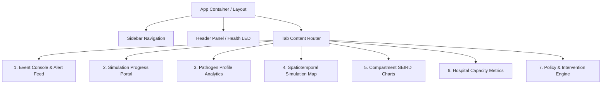
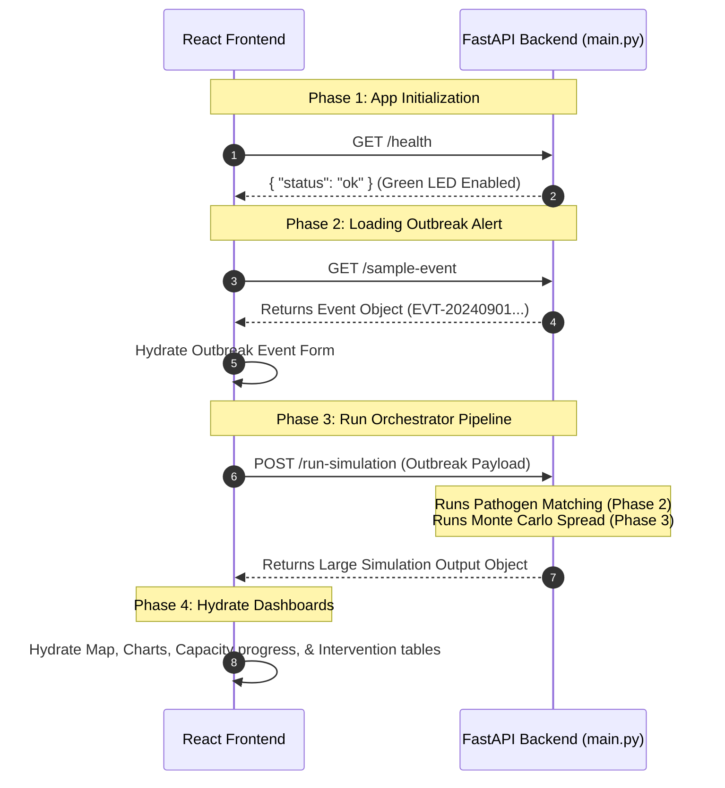

# OutbreakResponseOS: Senior Frontend Architect Plan

This document provides a highly detailed, comprehensive front-end architectural blueprint and implementation plan for building a React + Tailwind CSS dashboard designed to interface with the OutbreakResponseOS FastAPI backend.

---

## 1. Complete Frontend Planning Breakdown

### 1.1 All Frontend Pages & Screens Required
We will structure the application as a **Single Page Application (SPA)** with a high-fidelity **Tabbed Command Dashboard** and an entry **Alert Control Deck**.

| Screen Name | Purpose | Primary UI Element |
| :--- | :--- | :--- |
| **1. Alert Monitor & Event Console** | View incoming Phase 1 outbreak alerts, edit parameters, and trigger simulation runs. | Split-screen: JSON Input / Schema Builder + Alert Feed Card List. |
| **2. Simulation Orchestration Portal** | Intermediary loading screen showing simulation pipeline progress and real-time backend log milestones. | Milestone progression indicator (Phase 2 Matching $\rightarrow$ Phase 3 Monte Carlo $\rightarrow$ Result Compilation). |
| **3. Pathogen Intelligence Deck** | Profile pathogen details, display matching templates, confidence scores, and seasonal parameters. | Grid of modern metrics cards + radial gauge charts. |
| **4. Spatiotemporal Simulation Map** | Visualize the epidemic spread geographically across Karnataka and interstate links over a 90-day timeline. | Interactive SVG/Leaflet map + 90-day time-scrubber playback controls. |
| **5. Epidemiologic Compartments Deck** | Chart SEIRD curves, analyze confidence bands (P10, P50, P90), and contrast lockdown scenarios. | Multi-line charting panel + scenario toggle cards. |
| **6. Healthcare Capacity & Overwhelm Monitor** | Track hospital bed saturation, peak infection timing, and overwhelmed districts. | Warning grid + color-coded horizontal bars showing bed occupancy ratios. |
| **7. Policy & Intervention Engine** | Review, filter, and simulate recommended edge closures (lockdowns) for transport links. | Ranked list with quick-toggle interactive controls. |

---

### 1.2 Display Requirements by Page

#### A. Alert Monitor & Event Console
- **Phase 1 Feed List**: A list of detected signals showing `event_id`, `location`, `signal_type` ("outbreak_event" vs. "watch_event"), `initial_risk_score`, and `first_detected_at`.
- **Active Event Details**: Metadata cards detailing:
  - Origin node ID (`origin_node_id`) with its coordinate coordinates.
  - Symptoms badge list (`symptoms_list` e.g., "fever", "rash", "joint_pain").
  - Integrity parameters: `source_credibility` (percentage gauge) and `confidence_score` (percentage gauge).
- **Interactive JSON Editor**: Toggleable view between a polished form and a raw JSON text editor for fine-tuning.

#### B. Simulation Orchestration Portal
- **Progress Milestone Stepper**:
  - **Milestone 1**: Pathogen Template Matching & Profiling (Phase 2)
  - **Milestone 2**: 50-Run Monte Carlo Simulation (Phase 3)
  - **Milestone 3**: Graph Edge & Transmissibility Evaluation
  - **Milestone 4**: SEIRD Trajectory Writing & Output Assembly
- **Dynamic Simulator Status Bar**: Running terminal logs or simulated spinner explaining exactly what is running on the backend.

#### C. Pathogen Intelligence Deck
- **Primary Disease Profile**: The matched template name (`disease_name` highlighted in large bold typography) and template matching confidence (`template_confidence`).
- **Pathogen Variables Grid**:
  - **$R_0$ Transmission**: Standard $R_0$ estimate (`R0_estimate`) accompanied by the confidence boundaries (`R0_lower_95` to `R0_upper_95`).
  - **Mortality Rate**: Mortality percentage (`mortality_rate`).
  - **Seasonal Multiplier**: Current modifier coefficient (`seasonal_multiplier` e.g., `1.30`) and monthly trend indicator.
  - **Data Fidelity Indicator**: Visual pill badge showing the calculated confidence level: `HIGH` (Emerald), `MEDIUM` (Amber), or `LOW` (Rose) based on source credibility and report count.

#### D. Spatiotemporal Simulation Map
- **Karnataka Map Layer**: Visualizes geographic locations of 12 districts (`KA-01` to `KA-12`) and 10 Interstate hubs (`EXT-01` to `EXT-10`) colored dynamically by active infections `I(t)` on the selected day `t`.
- **Mobility Web Edges**: Connecting vectors between nodes. Edge width maps to edge capacity (`weight`), and dash style/color maps to transport types (`modes` like "rail", "air").
- **Day Playback Scrub**: An interactive slider (Day 0 to Day 90) with "Play", "Pause", "Speed x1/x2", and "Reset" buttons. Scrubbing dynamically redraws node colors and shows the wave of spread spreading out from the origin.

#### E. Epidemiologic Compartments Deck
- **Interactive SEIRD Plot**: Shows the five compartment populations over 90 days.
  - **Susceptible (S)**: Cyan line.
  - **Exposed (E)**: Yellow line.
  - **Infected (I)**: Red line (with shaded region for P10-P90 confidence limits).
  - **Recovered (R)**: Emerald line.
  - **Dead (D)**: Slate/Gray line.
- **Scenario Toggle Panel**: Sidebar to switch datasets between:
  - **Scenario A**: No Lockdown (Default, using `res_no_lockdown` bands).
  - **Scenario B**: Partial Lockdown (Removes top 5 edges).
  - **Scenario C**: Full Lockdown (Removes top 15 edges).
- **Peak Metrics Cards**: Cards showing Peak Infected day (`peak_infection_day`) and Peak Infected Count (`peak_I_p50`).

#### F. Healthcare Capacity & Overwhelm Monitor
- **Saturation Scoreboard**: Sorting cards highlighting districts that overwhelm their capacity (`overwhelmed == true`).
- **Districts Capacity Progress**: Grid comparing Peak Infected (`peak_I_p50`) vs. Overwhelm Threshold (`overwhelm_threshold` = `total_beds * 0.3`). Shows percentage bar with marker at the 30% saturation threshold.
- **Duration of Saturation Grid**: Cards detailing the first day of overwhelm (`first_overwhelm_day`) and duration (`days_overwhelmed` in days).

#### G. Policy & Intervention Engine
- **Ranked Lockdown Targets**: Table displaying the top 15 transport vectors ranked by containment score (`combined_score` descending).
- **Transport Edges Checklist**: Columns: `Rank`, `Origin $\leftrightarrow$ Destination`, `Transport Modes` (Icons for Air/Rail), and `Containment Score`.
- **Intervention Playgrounds**: Quick buttons to toggle specific edges on or off manually to design customized lockdown scenarios.

---

### 1.3 Inputs & Forms Needed

#### A. Outbreak Event Constructor Form
Allows health officials to manually register or edit a Phase 1 Outbreak Alert:
- **Location Selector**: Dropdown (e.g. "Bengaluru, Karnataka", "Mysuru, Karnataka").
- **Origin Node ID Dropdown**: Maps to nodes `KA-01` to `KA-12`.
- **Symptoms Tag Input**: Multiselect list of symptoms (e.g., fever, rash, joint pain, cough, hemorrhage).
- **Initial Risk Score**: Slider input `[0 - 100]` (default: 72.5).
- **Confidence Score Slider**: Decimal slider `[0.0 - 1.0]` (default: 0.81).
- **Source Credibility Slider**: Decimal slider `[0.0 - 1.0]` (default: 0.78).
- **Report Count Input**: Number input (default: 14).
- **Signal Type Dropdown**: "outbreak_event" (computes full lockdowns, high fidelity) vs. "watch_event" (triggers low-fidelity mode, faster, no lockdown optimization).
- **Zone Dropdown**: "metro", "rural", "urban", "coastal" (directly influences seasonal multipliers).
- **Simulation Timeframe Input**: Days slider (e.g., 30, 60, 90, 120 days).

---

### 1.4 API Integrations
The React frontend will connect to the FastAPI endpoints as follows:

```mermaid
graph TD
    A[React Frontend] -->|GET /health| B(FastAPI Server)
    A -->|GET /sample-event| B
    A -->|POST /run-simulation| B
    A -->|GET /results/{event_id}| B
```

- **Endpoint 1: `GET /health`**
  - Triggered: Automatically on page mount.
  - Usage: Validates server connectivity. Changes a small pulsing LED badge in the header (Green: Active, Red: Offline).
- **Endpoint 2: `GET /sample-event`**
  - Triggered: User clicks "Load Sample Alert" on the Event Console.
  - Usage: Retrieves pre-baked JSON payload to populate the form instantly.
- **Endpoint 3: `POST /run-simulation`**
  - Triggered: User clicks "Trigger Simulation".
  - Payload: The outbreak event JSON structure.
  - Response: Full nested simulation results including `profile`, `nodes` list with confidence bands, `edges` mobility lists, and `lockdown_recommendations`.
- **Endpoint 4: `GET /results/{event_id}`**
  - Triggered: User searches for an active run or inputs a known historical `event_id`.
  - Usage: Loads cached simulation configurations.

---

### 1.5 State Management Strategy
Because the simulation generates nested, rich multi-dimensional data, we need a unified state store.
- **Technology Choice**: **React Context API** for high-level metadata combined with lightweight **Zustand** or **Redux Toolkit** if persistent state storage is required. For the initial implementation, a clean React Context with `useReducer` is perfect.
- **Global Context Parameters**:
  ```typescript
  interface SimulationState {
    healthStatus: 'online' | 'offline';
    activeEventPayload: OutbreakEvent | null;
    simulationResults: SimulationResults | null;
    isSimulating: boolean;
    activeTab: 'map' | 'pathogen' | 'epidemic' | 'capacity' | 'policy';
    timeline: {
      currentDay: number;
      isPlaying: boolean;
      playbackSpeed: number; // 1x, 2x, 5x
    };
    interventions: {
      activeScenario: 'no_lockdown' | 'partial_lockdown' | 'full_lockdown';
      customClosedEdges: string[]; // List of custom closed edge IDs
    };
    hoveredNode: string | null; // ID of KA or EXT node hovered on map/table
  }
  ```

---

### 1.6 Frontend Folder Structure

We suggest a clean, scalable folder structure based on Vite:

```text
outbreak-frontend/
├── public/
│   └── assets/                     # GeoJSON assets, icons
├── src/
│   ├── assets/                     # Local SVGs/Images
│   ├── components/                 # Reusable UI Elements
│   │   ├── atoms/                  # Button, Badge, LoadingSpinner, Tooltip
│   │   ├── molecules/              # StatCard, AlertItem, ProgressStepper
│   │   ├── organisms/              # EventForm, SimulationMap, SEIRDChart, CapacityTable
│   │   └── layout/                 # Sidebar, Header, PageContainer
│   ├── context/
│   │   └── SimulationContext.jsx   # Global application state provider
│   ├── hooks/
│   │   ├── useSimulation.js        # Context hook accessor
│   │   └── useTimeline.js          # Encapsulates scrubber/play interval logic
│   ├── services/
│   │   └── api.js                  # Axios/Fetch setup for FastAPI client wrapper
│   ├── utils/
│   │   ├── formatters.js           # Population compact formats, date formatting
│   │   └── geoHelpers.js           # Lat/Lon to SVG coordinate converters
│   ├── App.jsx                     # Root application wrapper with Layout
│   ├── index.css                   # Custom styling rules and Tailwind tail imports
│   ├── main.jsx                    # Core React renderer entry point
│   └── mockData.js                 # Local mock datasets for local testing
├── tailwind.config.js              # Tailwind custom configurations
├── package.json
└── vite.config.js
```

---

### 1.7 Suggested React & Tailwind Architecture
- **CSS Strategy**: We utilize **Vanilla CSS Variables** inside `index.css` mapped directly to Tailwind utility configurations.
- **Visual Aesthetic**: A premium **Sleek Cyber-Medical Dashboard** using a glassmorphic design:
  - **Theme**: Unified Dark Mode. Deep indigo backgrounds combined with glowing indicators.
  - **Glassmorphic Styling**:
    - `bg-slate-950/80 backdrop-blur-md border border-slate-800/60 shadow-xl`
  - **Tailwind Palette Expansion** (inside `tailwind.config.js`):
    - `brand-dark`: `#070a13` (rich space black)
    - `brand-panel`: `#0f1524` (glass core base)
    - `accent-cyan`: `#00f0ff` (glowing clinical blue)
    - `accent-teal`: `#00f5d4` (infectious spread indicator)
    - `accent-rose`: `#ff007f` (high-risk overwhelm/death)
  - **Typography**: Import **Space Grotesk** or **Outfit** from Google Fonts to replace default sans-serif, giving it a high-tech science aesthetic.

---

### 1.8 Loading, Error, & Success States

1. **Loading State**:
   - **Global Sim-Run Stepper**: When triggering the pipeline, instead of a simple spinner, show a dynamic dashboard displaying Phase 2 template matching status, moving seamlessly to Monte Carlo progression.
   - **Component Skeleton**: Grid cards should use shimmering placeholders (`animate-pulse bg-slate-800`).
2. **Error State**:
   - **Toast Notifications**: Interactive floating alerts if `/run-simulation` encounters errors (e.g., malformed payload or timeout).
   - **Invalid Field Warning**: Form validation highlighting invalid inputs (e.g., R0 upper bound smaller than lower bound) before submitting.
3. **Success State**:
   - **Data-Hydration Pulse**: A momentary glowing halo animation around key metric panels when the API returns the results successfully.

---

### 1.9 Missing Backend Endpoints (Architect's Critical Review)
To build a truly complete and fluid frontend, we have identified several gaps in the current backend (`main.py`):

1. **Lockdown Scenario Trajectories JSON Endpoint**:
   - **Problem**: The backend currently runs three distinct simulation runs inside `pipeline.py` (`res_no_lockdown`, `res_partial`, `res_full`) and writes them directly to a local CSV file (`seird_results.csv`), but the JSON endpoint `/run-simulation` only returns the nodes data *specifically* for the `res_no_lockdown` (No Lockdown) scenario.
   - **Solution Required**: Modify the `/run-simulation` JSON output schema to return trajectories for all three simulated scenarios in a unified dictionary structure (e.g., `nodes_no_lockdown`, `nodes_partial_lockdown`, `nodes_full_lockdown`). This avoids forcing the frontend to read a raw local CSV file directly from disk!
2. **Historical Simulation Index (`GET /simulations`)**:
   - **Problem**: The backend maintains `results_store` in-memory keyed by `event_id`, but does not provide an endpoint to list all completed events.
   - **Solution Required**: Expose a quick `GET /simulations` endpoint returning a summary array of available `event_ids`, matched pathogen names, and dates.
3. **Dedicated Network Graph Endpoint (`GET /network/mobility`)**:
   - **Problem**: The client currently reads edges during the simulation run, but a user should be able to view and explore the empty network graph layout (districts + transport weights) before triggering any disease simulation.
   - **Solution Required**: Expose `GET /network/mobility` to serve the base nodes and railway/air edges data prior to simulation.

---

### 1.10 UX Improvements & Reusable Components
- **timeline Scrubber Playback**: Add speed adjusters (`0.5x`, `1.0x`, `2.0x`, `5x`) to allow smooth playback over the 90 simulated days.
- **Regional Filters**: Toggles to view "Karnataka Only", "Inter-State Only", or "Overwhelmed Hubs".
- **Dynamic Tooltips**: Hovering over any district node on the map reveals its exact bed counts, peak infection day, and current state of health capacity.

---

## 2. Structural Diagrams & Blueprints

### 2.1 Page Hierarchy



---

### 2.2 Component Hierarchy

```text
App
├── Layout
│   ├── Header (HealthStatusBadge, EventIDSelector)
│   └── Sidebar (TabNavigationLink, ActiveScenarioDropdown)
└── MainDashboardContent
    ├── Tab: Alert Console
    │   ├── EventConstructorForm (LocationDropdown, SymptomsListInput, RiskSlider, LaunchBtn)
    │   └── AlertFeedPanel (AlertCard, SignalFidelityPill)
    ├── Tab: Spatiotemporal Map
    │   ├── InteractiveVectorMap (SVGNode, SVGEdgeVector, OriginIndicator)
    │   ├── TimelinePlaybackController (PlayBtn, PauseBtn, TimelineSlider, DayBadge)
    │   └── MapSidebarStatistics (NodeMiniStatsCard, CurrentOverwhelmedCount)
    ├── Tab: Epidemic Curves
    │   ├── RechartsSEIRDPlot (LineChart, ConfidenceBoundShadow, XAxisTimeScrub)
    │   └── ScenarioComparisonSelector (RadioScenarioBtn, StatsComparisonTable)
    ├── Tab: Hospital Capacity
    │   ├── CapacityWarningStrip (CriticalBedsBanner)
    │   ├── BedSaturationProgressBar (DistrictProgressBar, OverwhelmMarker)
    │   └── CapacityAnalyticsTable (NodeIdColumn, PeakDayCol, SaturationDurationCol)
    └── Tab: Interventions
        ├── LockdownTable (EdgeRow, ToggleLockdownSwitch, WeightIndicator)
        └── ScenarioSimulationLauncher (ReRunScenarioBtn)
```

---

### 2.3 API Integration Map & Data Flow



---

### 2.4 Suggested UI Layout Design
The proposed design is a beautiful multi-column clinical-intelligence system:

```text
+------------------------------------------------------------------------------------+
| [OutbreakResponseOS]       Event: [EVT-20240901]      [Server Status: ONLINE (LED)]|
+------------------------------------------------------------------------------------+
|  (TABS)                                                                            |
|  [ Alert Feed ]  [* Spatiotemporal Map *]  [ SEIRD Curves ]  [ Bed Saturation ]    |
+------------------------------------------------------------------------------------+
|  LEFT PANEL: Controls & Scenarios      |  CENTER: Interactive Geographic Map        |
|                                        |                                            |
|  [ Scenario Selector ]                 |       (EXT-08 Delhi)                       |
|   (o) Scenario A: No Lockdown          |                                            |
|   ( ) Scenario B: Partial Lockdown     |                                            |
|   ( ) Scenario C: Full Lockdown        |                  (KA-06 Kalaburagi)        |
|                                        |                                            |
|  [ Timeline Playback Controls ]        |        (KA-04 Hubballi) ------> (KA-01)    |
|   [ Play ] [ Pause ] [ Speed: 2x ]     |                                            |
|   Day: |=========o========| Day 45     |                  (KA-02 Mysuru)            |
|                                        |                                            |
|  [ Map Filters ]                       |                                            |
|  [x] Karnataka [x] Interstate          |  Legend: [Red: Saturation] [Green: Low I]   |
+----------------------------------------+-------------------------------------------+
|  RIGHT PANEL: Selected Hub Details     |  BOTTOM: Simulation Pathogen Properties    |
|  Active Hub: KA-01 (Bengaluru Urban)   |  Pathogen: DENGUE (Confidence: 82%)        |
|  - Population: 13,193,000              |  R0 Estimate: 3.14 (95% CI: 2.1 - 4.5)     |
|  - Hospital Beds: 28,000               |  Mortality: 0.1%                           |
|  - Status: OVERWHELMED (since Day 18)  |  Fidelity Rank: HIGH                       |
+------------------------------------------------------------------------------------+
```

---

## 3. High-Fidelity Tailwind & React Implementation Guide

### 3.1 Pre-built Glassmorphic Panel Component
Below is the reusable structural component to establish the layout's aesthetic:

```jsx
import React from 'react';

export const DashboardPanel = ({ title, children, className = "" }) => {
  return (
    <div className={`bg-slate-900/75 backdrop-blur-md border border-slate-800/80 rounded-2xl p-6 shadow-2xl transition-all duration-300 hover:border-slate-700/60 ${className}`}>
      {title && (
        <div className="flex items-center justify-between mb-4 border-b border-slate-800 pb-3">
          <h3 className="text-sm font-semibold tracking-wider text-slate-400 uppercase">{title}</h3>
          <span className="w-2 h-2 rounded-full bg-cyan-400 animate-pulse" />
        </div>
      )}
      {children}
    </div>
  );
};
```

---

## 4. Frontend Road Map (Step-by-Step Build Order)

1. **Milestone 1: Scaffold & Establish Design Tokens** (Days 1-2)
   - Initialize Vite React project. Load fonts and build theme parameters inside `tailwind.config.js` and `index.css`.
   - Setup `SimulationContext` and layout foundations (Header, Sidebar Navigation, active tab toggles).
2. **Milestone 2: Outbreak Alert Input Panel** (Days 3-4)
   - Create the Event Constructor Form validation schema.
   - Build symptom tag array inputs and range sliders.
   - Integrate `GET /sample-event` to auto-populate default forms.
3. **Milestone 3: Interactive Visual Map & timeline Scrubber** (Days 5-7)
   - Build coordinates-to-SVG mapping system for Karnataka + Interstate nodes.
   - Map railway and airline edge vectors dynamically.
   - Implement timeline context hook to manage the active Day index (`0` to `90`) with step play intervals.
4. **Milestone 4: Epidemiologic Curves & Scenario Comparison** (Days 8-9)
   - Integrate Recharts plot showing SEIRD curves.
   - Design shading layer to visualize the P10 $\leftrightarrow$ P90 confidence area around infected trajectories.
   - Establish tabs to render No Lockdown, Partial, and Full Lockdown simulations.
5. **Milestone 5: Healthcare Saturation Monitoring Deck** (Day 10)
   - Design visual indicators mapping peak infections to hospital bed capacities.
   - Construct progress bars marking the overwhelmed 30% saturation ceiling.
6. **Milestone 6: Polishing & Interactive Integration** (Days 11-12)
   - Connect the POST payload pipeline. Add elegant transition orchestration milestones.
   - Integrate health LED ping checks.
   - Perform layout testing and ensure responsive adaptiveness for multi-screen monitoring.

---

### Final Blueprint Sign-off
These are the essential frontend requirements for this backend.
